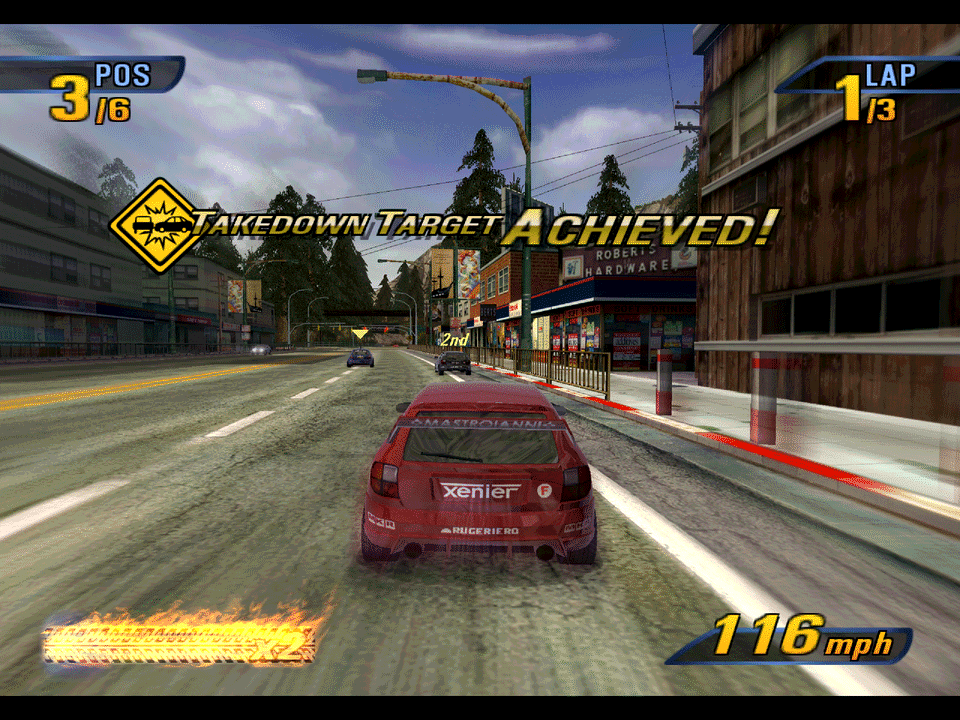
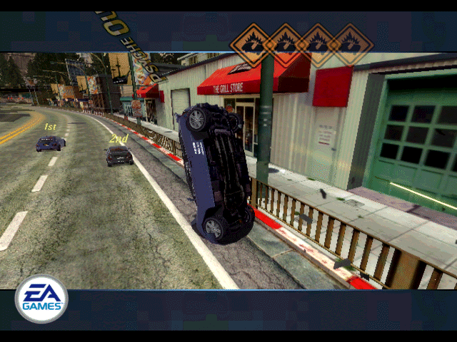
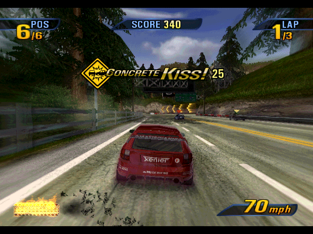
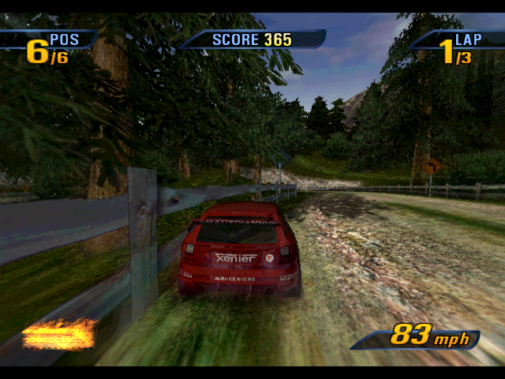
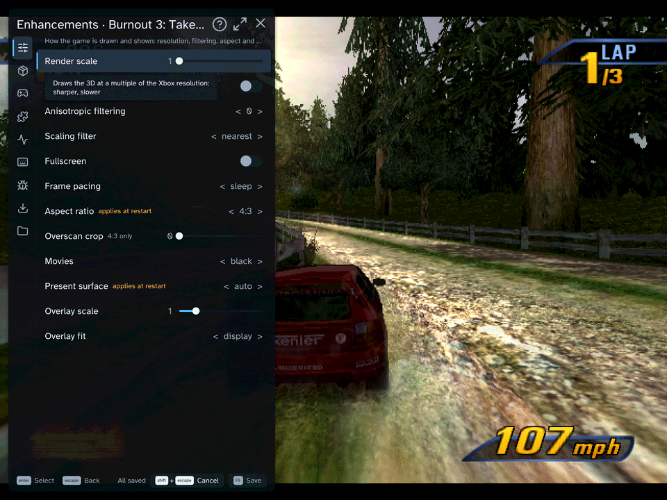
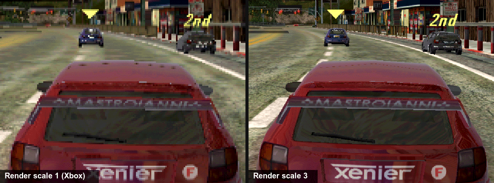
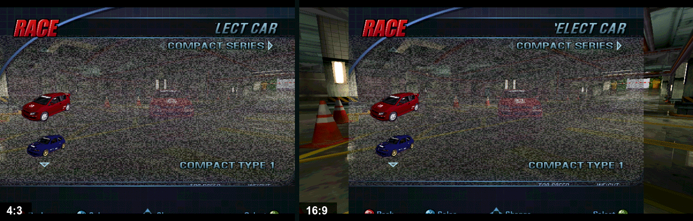
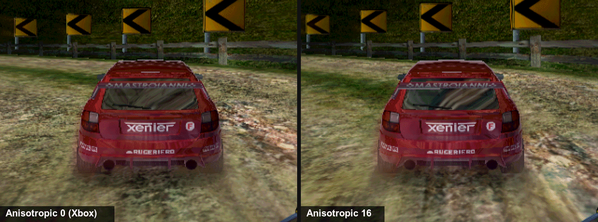
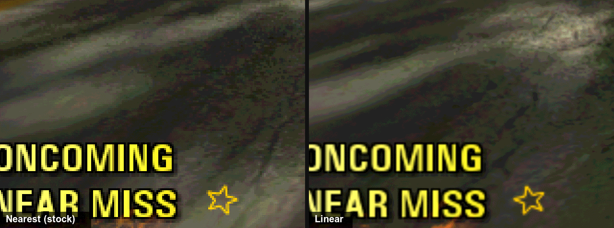

# Burnout 3: Takedown

*Burnout 3: Takedown* is Criterion's 2004 racing game, where you win by
crashing your rivals off the road. This project turns your own copy of
the Xbox disc into a game that runs on Windows, a Mac or a Steam Deck. No
emulator, and no disc in a drive once it is built. It is a fork of
[sp00nznet/burnout3](https://github.com/sp00nznet/burnout3) by sp00nz.

<!-- xbr:readme:download -->
> [!TIP]
> **Get the builder:** download the wizard for your computer from the
> [latest release](https://github.com/apexJCL/burnout3-recomp/releases/latest),
> point it at your own disc image, and it builds and installs the game for you.
>
> | Your computer | Download |
> |---|---|
> | Windows 10 or 11 (x86-64) | `burnout3-wizard-<version>-windows-x64.zip` |
> | Mac (Apple silicon) | `burnout3-wizard-<version>-macos.zip` |
> | Steam Deck or Linux PC | `burnout3-wizard-<version>-linux-x64.tar.gz` |
<!-- /xbr:readme:download -->

**No game is included.** You need your own copy of Burnout 3: Takedown; everything the
builder makes from it stays on your machines.

<!-- xbr:readme:release -->
> [!IMPORTANT]
> **Supported game version.** This port is built for one release of
> Burnout 3: Takedown only:
>
> | | |
> |---|---|
> | Title | Burnout 3 |
> | Title ID | `0x4541005B` |
> | Region | NTSC-U |
> | Version | 1 |
> | `default.xbe` sha256 | `9f497acd82adb8edfb72cc31aeeb35010b45d32b13a3f1fc6540717ff24d13f9` |
>
> The wizard checks your copy on its Dump page before it builds; by hand,
> `./burnout3 fingerprint /path/to/your/disc.iso` says the same. Another
> region or version is **not supported**: it warns "another release", and
> the game may crash or misbehave. A modded copy warns too.
<!-- /xbr:readme:release -->

## How the builder works

<!-- xbr:readme:wizard -->
- Checks your computer and fetches the build tools it needs, each download
  checked against a known checksum. It sends nothing of yours.
- Checks your disc image or game folder, and says before building when it
  is another release or a modded copy.
- Builds an installer for this computer, or for another one: a Windows setup
  program, a Mac app (`.dmg`) or a Steam Deck bundle that adds the game to
  Steam.
- Lets you pick the basic options before building:
  - Render scale
  - Start fullscreen
- Makes small updates for a device that already has a build, and reuses
  most of the work when you build again.
<!-- /xbr:readme:wizard -->

Step by step, with the SmartScreen and Gatekeeper prompts, and the by-hand
route: [docs/playing.md](docs/playing.md#build-the-game).

## Status

**Every game mode boots, renders and plays,** one or two players, with a
controller, at full speed on Direct3D 11 and Metal. Xbox Live and System
Link are not attempted.

| You play on | Graphics | State |
|---|---|---|
| Windows 10 or 11 | Direct3D 11 | Builds and installs; checked to start and reach Press START on Windows 11. Played and tested under Proton. |
| Steam Deck, Linux (Proton) | Direct3D 11 (DXVK) | Plays: a scripted race runs at about 57 frames a second on the Deck. |
| Mac (Apple silicon) | Metal | Plays: the same race runs at about 55 frames a second. The title and menu music is silent. |

Top known issues (all of them: [docs/playing.md](docs/playing.md#known-issues)):

- The title screen and menu music is silent on the Mac.
- No profile saving, so the tutorial video plays at every start.
- Upstream's list for its toolkit: vertical streaks over the menu backdrop
  movie, seams in the sky dome, and bump-mapped texture stages read as zero.
- Xbox Live and System Link are not attempted.
- On the Steam Deck the game starts in a window: add it to Steam with the
  Gamepad template.

## Showcase

Upstream's own screenshots, taken on its software renderer, are in
[docs/screenshots](docs/screenshots).

### The in-game menu

F10 on the keyboard (Guide+A, or Back+L3 held on a pad) opens a menu over
the game while it keeps running. Its pages: Render (scale, aspect,
filtering), Shaders, Mods, Stats, Controls, Saves and Files. Most settings
apply at once; Save keeps what you changed.

### Mods and enhancements

Every mod is off, or at the Xbox's setting, unless the table says
otherwise. Open the in-game menu, go to the page in the table and change
the option; most apply at once, and Save keeps them for the next start.
The wizard also asks for the render scale before it builds.

| Mod | Menu page | What it does | Default |
|---|---|---|---|
| **Render scale** | Render | Draws the 3D at 1 to 4 times the Xbox's 640x480: sharper, slower. | 1 |
| **Aspect ratio** | Render | Widescreen: 16:9, 16:10 or 21:9 show more at the sides instead of stretching the picture (from the next start). | 4:3 |
| **Anisotropic filtering** | Render | Sharper ground and walls seen at a slant: 2, 4, 8 or 16. | 0 |
| **Overscan crop** | Render | Crops the border an old TV hid, and zooms the rest (4:3 only). | 0 |
| **2D on guest grid** | Render | Keeps 2D art on the Xbox's pixel grid at render scale 2 and up, so tiled menus and HUD show no seams. | off |
| **Scaling filter** | Render | How the picture is stretched to the window: nearest is crisp, linear smooth, integer whole multiples only. | nearest |
| **Profile** | Shaders | A shader over the picture: crt-lottes, crt-lottes-fast or crt-hyllian for an old TV's look, fsr to upscale. | Off |

#### Render scale

The Xbox drew every game at 640x480. Render scale 2 draws the 3D at
1280x960 and 3 at 1920x1440; the wizard asks for it, and Render > Render
scale changes it while you play.

#### Aspect ratio

Render > Aspect ratio > 16:9 keeps the game's height of view and shows
more at the sides; it takes effect at the next start.

#### Anisotropic filtering

Render > Anisotropic filtering > 16 keeps a texture sharp where it runs
away from the camera, as a road or a floor does.

#### Overscan crop

A still shows only a zoom. Its origin: a TV of the time hid a band around
the picture, so console games kept their HUD away from the border, and
some left junk there. Overscan crop cuts that band and fills the window
with the rest. It works at 4:3 only.

#### 2D on guest grid

Above render scale 1 the 3D gets sharper, but 2D art made of tiles (menus,
the HUD, fonts) can show thin seams where the tiles meet, because each tile
now samples between the Xbox's pixels. This keeps 2D on the Xbox's own
pixel grid, as at scale 1: no seams, blockier 2D art.

A still shows nothing here. Its origin: Burnout 3's menus and HUD show
no seams at render scale 3, so their 2D art looks the same with this off
and on. It is there for games whose tiled 2D does seam.

#### Scaling filter

The Xbox drew for a TV; a window is larger, so the picture is stretched to
fit. Nearest keeps every pixel sharp, linear blends them for a softer
picture, and integer scales by whole multiples only, with a border, so
every pixel is the same size.

#### Profile

Shaders > Profile > crt-lottes draws the picture like an old TV, with
scanlines and a shadow mask; crt-hyllian is another look, and fsr is
AMD's upscaler instead. The Shaders page tunes each one, and saves a chain
of them as a profile of your own.

## Build requirements and common gotchas

- About 15 GB free for the build, plus room for the installer.
- A Windows 10 or 11 PC, an Apple silicon Mac, or a Steam Deck or Linux PC
  (in Desktop Mode on the Deck).
- An internet connection for the first build (the tools download once).
- Your copy is the supported version (the box above).

The failures players hit most:

- **"Another release":** your disc is another region or revision than the
  one this port is made from. The build may stop, or the game misbehave.
- **Mac: "the app is damaged" or cannot be opened:** that is Gatekeeper.
  Right-click the app and pick Open, once.
- **Steam Deck: the game starts in a window, and the pad does not reach
  it:** in Desktop Mode add it to Steam (`./install.sh --steam`), pick the
  Gamepad template in its controller settings and start it from Steam.

The rest: [docs/playing.md](docs/playing.md#troubleshooting).

## Report a bug

[Open a bug report](https://github.com/apexJCL/burnout3-recomp/issues/new?template=bug_report.yml):
the form asks for what we need (your game version, the build version, where
you play, your settings and the logs). Never attach game files, a disc
image, a save or a built bundle. Problems with the wizard or the `./burnout3`
commands themselves go to
[xboxrecomp-cli's issues](https://github.com/apexJCL/xboxrecomp-cli/issues).

## More documentation

| Document | For |
|---|---|
| [docs/playing.md](docs/playing.md) | building by hand, installing, the options, the in-game menu, known issues, troubleshooting |
| [docs/developers.md](docs/developers.md) | how the port works, building from source, the toolchain and its pins, contributing |
| [CHANGELOG.md](CHANGELOG.md) | what changed for players in each release |

**Sister project.** [BLiNX 2: Masters of Time & Space](https://github.com/apexJCL/blinx2-recomp)
is recompiled with the same toolkit and build wizard, and is the furthest along.

## Legal

This repository contains **no game data and no game code**: no game files,
assets or saves, and no lifted (recompiled) game code. `src/game/recomp/gen/` is
generated on your machine by the pipeline and is never committed.

To build it you need your own legally obtained copy of Burnout 3: Takedown. Burnout 3: Takedown and its assets belong to their owners; this project
is not affiliated with them.
A bundle made by `burnout3 package` contains your copy of the game and code
generated from it: it is for your own machines only, and is not yours to
redistribute.

### License and credits

MIT, see [LICENSE](LICENSE). This covers the code in this repository only.
Contributions are welcome; read [CONTRIBUTING.md](CONTRIBUTING.md) first,
especially *Where your code comes from*. The toolkit that the
build links in statically carries LGPL-2.1 APU code extracted from xemu: if
you distribute a built binary, read [NOTICE](NOTICE) first.

Built on [xboxrecomp](https://github.com/sp00nznet/xboxrecomp) by sp00nz,
through the [apexJCL/xboxrecomp](https://github.com/apexJCL/xboxrecomp) fork, and on
[xboxrecomp-cli](https://github.com/apexJCL/xboxrecomp-cli). 
This is [apexJCL/burnout3-recomp](https://github.com/apexJCL/burnout3-recomp),
a fork of [sp00nznet/burnout3](https://github.com/sp00nznet/burnout3) by
sp00nz, which keeps upstream's history and build; its Windows route with
Visual Studio is in [docs/developers.md](docs/developers.md#upstreams-route-windows-and-visual-studio).
Contributors: [CONTRIBUTORS.md](CONTRIBUTORS.md).
